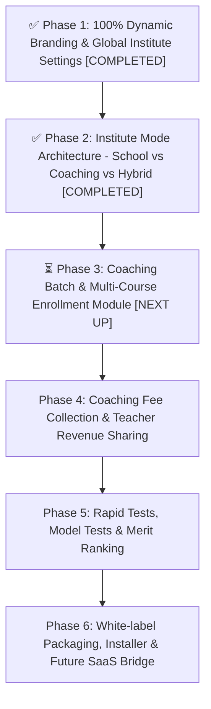

# Dynamic Multi-Institute & Coaching Management Transformation Plan

This plan outlines the complete architectural roadmap to transform Porua.app from a single-school configured application into a **fully dynamic, white-label Education ERP** capable of operating smoothly in **School Mode**, **Coaching Center Mode**, or **Hybrid (School + Coaching) Mode**.

The plan is divided into distinct sequential phases. Execution proceeds strictly **one phase at a time**, ensuring each step is built with deep perfection and rigorous testing before moving forward.

---

## 📊 Roadmap Progress Tracker

| Phase | Module Name | Status | Completion Date | Scope Summary |
| :--- | :--- | :---: | :---: | :--- |
| **Phase 1** | **Dynamic Branding & Global Settings Engine** | ✅ **COMPLETED** | 2026-09-20 | 100% de-hardcoding, dynamic logo/favicon, global Inertia sharing, cache invalidation, all print/reports dynamic |
| **Phase 2** | **Institute Mode Architecture (School / Coaching / Hybrid)** | ✅ **COMPLETED** | 2026-09-20 | Interactive mode selector, terminology engine (`useTerminology`), adaptive sidebar navigation, active mode badge |
| **Phase 3** | **Coaching Batch & Multi-Course Enrollment Module** | ⏳ **NEXT UP** | Pending User Call | Courses, batches, day-wise schedule, batch enrollment, student multi-batch association |
| **Phase 4** | **Coaching Flexible Fee Collection & Teacher Revenue Sharing**| 📋 Queued | Planned | Batch fees, installment billing, teacher commission (% share / per-lecture fee) payouts |
| **Phase 5** | **Coaching Rapid Tests, Model Tests & Merit Ranking** | 📋 Queued | Planned | Weekly quizzes, model tests, batch-wise ranking, marks SMS & merit list generator |
| **Phase 6** | **White-label Packaging & Future SaaS Engine Bridge** | 📋 Queued | Planned | Interactive first-run setup wizard, automated installer, tenant migration bridge |

---

## Architecture Strategy: Single-Tenant White-label First -> SaaS Engine Later

Based on your business model, customer requirements in Bangladesh, and the existing deep integration with **ZKTeco biometric devices**:
- **Current Architecture (Phase 1-6):** Single Codebase with Multi-Institute White-labeling. Every instance can be easily configured or hosted on dedicated subdomains (e.g. `school1.porua.app`, `coaching1.porua.app`) or custom client domains with 100% data separation, custom branding, and zero data-leak risks.
- **Future Scale (Phase 7):** Central Multi-Tenant SaaS Engine (using `Stancl/Tenancy` or single-DB multi-tenant partition) once business volume scales beyond 20+ institutions.

---

## Phase Breakdown Overview

---

## Detailed Phases & Execution History

---

### [x] Phase 1: Dynamic Branding & Global Settings Engine (100% De-hardcoding) — ✅ [COMPLETED]
*Objective: Remove every trace of hardcoded school information ("Mousumi Bidyaniketon", address, phone, static logo) and make the entire application dynamically adapt to the active institution's settings.*

- **Status**: **100% Completed & Verified**
- **Completion Date**: 2026-09-20
- **Build Verification**: `npm run build` executed successfully (0 errors across 90+ pages).
- **Codebase Scan**: Ripgrep verified 0 hardcoded occurrences remaining across `resources/views` and `resources/js`.

#### Execution Details & Completed Changes

1. **Backend - Dynamic Settings Engine & Storage**:
   - [Setting.php](file:///c:/Code/1.%20TRUST%20IT/Porua.app/app/Models/Setting.php): Added automatic cache invalidation on save/delete using `booted()` event listener (`Cache::forget('global_institute_settings')`).
   - [SettingController.php](file:///c:/Code/1.%20TRUST%20IT/Porua.app/app/Http/Controllers/SettingController.php): Added file upload support for `institute_logo` and `institute_favicon` (stored in `public/settings/` via `Storage::disk('public')`), and institute profile fields (`institute_name`, `school_name`, `school_code`, `school_email`, `school_phone`, `school_address`, `school_website`, `established_year`, `currency_symbol`, `invoice_footer_text`, `institute_type`).
   - [HandleInertiaRequests.php](file:///c:/Code/1.%20TRUST%20IT/Porua.app/app/Http/Middleware/HandleInertiaRequests.php): Loads cached institute settings (`global_institute_settings`) and shares a global `institute` object in props on every request.
   - [app.blade.php](file:///c:/Code/1.%20TRUST%20IT/Porua.app/resources/views/app.blade.php): Dynamic page title and dynamic favicon from cached settings.
   - [report-print.blade.php](file:///c:/Code/1.%20TRUST%20IT/Porua.app/resources/views/attendance/teachers/report-print.blade.php): Dynamic footer institute name.
   - Executed `php artisan storage:link` to link public storage.

2. **Frontend - Centralized Context, Types & Settings UI**:
   - [types/index.d.ts](file:///c:/Code/1.%20TRUST%20IT/Porua.app/resources/js/types/index.d.ts): Defined `Institute` interface and added `institute: Institute;` to `SharedData`.
   - [useInstitute.ts](file:///c:/Code/1.%20TRUST%20IT/Porua.app/resources/js/hooks/useInstitute.ts): Created custom hook providing institute properties with clean fallback defaults.
   - [Settings/General.tsx](file:///c:/Code/1.%20TRUST%20IT/Porua.app/resources/js/pages/Settings/General.tsx): Redesigned settings UI with live logo/favicon upload previews and all institute detail inputs.

3. **Frontend - 100% De-hardcoded Pages & Templates**:
   - **Fees & Money Receipts**: [Receipt.tsx](file:///c:/Code/1.%20TRUST%20IT/Porua.app/resources/js/pages/Fees/Collections/Receipt.tsx), [PrintReport.tsx](file:///c:/Code/1.%20TRUST%20IT/Porua.app/resources/js/pages/Fees/Collections/PrintReport.tsx), [Index.tsx](file:///c:/Code/1.%20TRUST%20IT/Porua.app/resources/js/pages/Fees/Collections/Index.tsx).
   - **Student & Teacher ID Cards / Profiles**: [StudentIDCard.tsx](file:///c:/Code/1.%20TRUST%20IT/Porua.app/resources/js/pages/Students/StudentIDCard.tsx), [StudentPrintProfile.tsx](file:///c:/Code/1.%20TRUST%20IT/Porua.app/resources/js/pages/Students/StudentPrintProfile.tsx), [TeacherPrintIDCard.tsx](file:///c:/Code/1.%20TRUST%20IT/Porua.app/resources/js/pages/Teachers/TeacherPrintIDCard.tsx).
   - **Accounting & Financial Reports**: [DueReport.tsx](file:///c:/Code/1.%20TRUST%20IT/Porua.app/resources/js/pages/Accounting/Reports/DueReport.tsx), [ReceiptPayment.tsx](file:///c:/Code/1.%20TRUST%20IT/Porua.app/resources/js/pages/Accounting/Reports/ReceiptPayment.tsx), [StaffWelfareLoanLedger.tsx](file:///c:/Code/1.%20TRUST%20IT/Porua.app/resources/js/pages/Accounting/Reports/StaffWelfareLoanLedger.tsx), [IncomeExpenditure.tsx](file:///c:/Code/1.%20TRUST%20IT/Porua.app/resources/js/pages/Accounting/Reports/IncomeExpenditure.tsx), [BankReport.tsx](file:///c:/Code/1.%20TRUST%20IT/Porua.app/resources/js/pages/Accounting/Reports/BankReport.tsx), [BalanceSheet.tsx](file:///c:/Code/1.%20TRUST%20IT/Porua.app/resources/js/pages/Accounting/Reports/BalanceSheet.tsx), [Funds/Index.tsx](file:///c:/Code/1.%20TRUST%20IT/Porua.app/resources/js/pages/Accounting/Funds/Index.tsx).
   - **Attendance & Calendars**: [Teachers/Calendar.tsx](file:///c:/Code/1.%20TRUST%20IT/Porua.app/resources/js/pages/Attendance/Teachers/Calendar.tsx), [Students/Calendar.tsx](file:///c:/Code/1.%20TRUST%20IT/Porua.app/resources/js/pages/Attendance/Students/Calendar.tsx).
   - **Navigation, Authentication & Layout**: [Sidebar.tsx](file:///c:/Code/1.%20TRUST%20IT/Porua.app/resources/js/Components/Sidebar.tsx), [GuestLayout.tsx](file:///c:/Code/1.%20TRUST%20IT/Porua.app/resources/js/Layouts/GuestLayout.tsx), [Login.tsx](file:///c:/Code/1.%20TRUST%20IT/Porua.app/resources/js/pages/Auth/Login.tsx), [ForgotPassword.tsx](file:///c:/Code/1.%20TRUST%20IT/Porua.app/resources/js/pages/Auth/ForgotPassword.tsx), [GlobalLoadingIndicator.tsx](file:///c:/Code/1.%20TRUST%20IT/Porua.app/resources/js/Components/GlobalLoadingIndicator.tsx), [Dashboard.tsx](file:///c:/Code/1.%20TRUST%20IT/Porua.app/resources/js/pages/Dashboard.tsx), [Welcome.tsx](file:///c:/Code/1.%20TRUST%20IT/Porua.app/resources/js/pages/Welcome.tsx), [app.tsx](file:///c:/Code/1.%20TRUST%20IT/Porua.app/resources/js/app.tsx).

---

### [x] Phase 2: Institute Mode Architecture (School / Coaching / Hybrid) — ✅ [COMPLETED]
*Objective: Allow the administrator to toggle institute type so navigation, labels, and features dynamically adapt.*

- **Status**: **100% Completed & Verified**
- **Completion Date**: 2026-09-20
- **Build Verification**: `cmd /c "npm run build"` succeeded with 0 errors across 90+ pages in 16.04s.

#### Execution Details & Completed Changes:
1. **Interactive Mode Selector in Settings**:
   - [Settings/General.tsx](file:///c:/Code/1.%20TRUST%20IT/Porua.app/resources/js/pages/Settings/General.tsx): Built an interactive 3-way card selection component for:
     - **School / Madrasah Mode (`school`)**: Standard academic structure (Classes, Sections, Roll numbers, Annual promotions).
     - **Coaching Center Mode (`coaching`)**: Modular structure (Courses, Batches, Day-wise shifts, Student ID, Enrollments).
     - **Hybrid Mode (`hybrid`)**: Unified dual operation running regular school classes alongside coaching batches.
   - Connected directly to backend `Setting::set('institute_type', ...)` and cleared cache on submission.
2. **Terminology Engine Hook**:
   - [useTerminology.ts](file:///c:/Code/1.%20TRUST%20IT/Porua.app/resources/js/hooks/useTerminology.ts): Implemented hook calculating active mode labels dynamically:
     - `classLabel` & `classesLabel` ("Class" vs "Course" vs "Class / Course")
     - `sectionLabel` & `sectionsLabel` ("Section" vs "Batch" vs "Section / Batch")
     - `sessionLabel` & `sessionsLabel` ("Academic Year" vs "Batch Session" vs "Academic Session")
     - `rollLabel` ("Roll No" vs "Student ID" vs "Roll / ID")
     - `promotionLabel` ("Promotions" vs "Batch Transfer")
     - `modeBadgeTitle` ("School Mode" vs "Coaching Mode" vs "Hybrid (School & Coaching)")
3. **Adaptive Navigation & Header Badges**:
   - [Sidebar.tsx](file:///c:/Code/1.%20TRUST%20IT/Porua.app/resources/js/Components/Sidebar.tsx):
     - Integrated `modes` filter on `MenuItem` (e.g. `Promotions` automatically hides in Coaching Mode).
     - Labels for Academic Years, Classes, Sections, and Students dynamically display mode-appropriate terms.
     - Added an elegant mode badge directly in the Sidebar header.
   - [Navbar.tsx](file:///c:/Code/1.%20TRUST%20IT/Porua.app/resources/js/Components/Navbar.tsx): Added a color-coded active mode pill with glowing status dot in the top navigation bar (Emerald for School, Indigo for Coaching, Purple for Hybrid).

---

### [ ] Phase 3: Coaching Batch & Multi-Course Enrollment Module — ⏳ [NEXT UP]
*Objective: Empower coaching centers to manage independent batches, schedules, and multi-subject student enrollments.*

- **Status**: **Pending User Command to Begin**

#### Proposed Implementation Steps:
1. **Database Schema**:
   - `courses` table: `id`, `name`, `code`, `subject_id`, `fee_type` (monthly / one_time / package), `standard_fee`, `description`, `status`.
   - `batches` table: `id`, `course_id`, `name`, `teacher_id`, `room_no`, `days_of_week` (json: e.g. ["Sat", "Mon", "Wed"]), `start_time`, `end_time`, `max_capacity`, `status`.
   - `batch_enrollments` table: `id`, `student_id`, `batch_id`, `enrolled_date`, `status` (active/completed/dropped), `agreed_fee`, `discount_amount`, `notes`.
2. **Backend & Controllers**:
   - `CourseController`, `BatchController`, `BatchEnrollmentController`.
   - Batch-wise student attendance (manual or barcode/card punch).
3. **Frontend Pages**:
   - `Courses/Index.tsx`, `Batches/Index.tsx`, `Batches/Show.tsx` (view enrolled students, schedule, teacher).
   - Student profile: "Enrolled Batches" tab displaying all active batches and schedules.

---

### [ ] Phase 4: Coaching Flexible Fee Collection & Teacher Revenue Sharing — [QUEUED]
*Objective: Provide course-package billing, monthly batch billing, installment tracking, and teacher commission/revenue sharing.*

- **Status**: **Queued**

#### Proposed Implementation Steps:
1. **Fee Collection Tailoring**:
   - Support collection linked to `batch_enrollment_id` as well as school class fees.
   - Installment payments for fixed-price courses (e.g. Admission Crash Course: 15,000 BDT in 3 installments).
   - Specialized Coaching Money Receipt with batch names, class timings, and next due date.
2. **Teacher Remuneration & Commission**:
   - `teacher_payment_structures` table: Fixed monthly salary vs Revenue Percentage Share (e.g. 60% of batch collections) vs Per-Class Lecture Fee.
   - Monthly calculation sheet: Total collections per batch -> Teacher Share -> Instant payout generation directly integrated into existing `transactions` and `salaries` tables.

---

### [ ] Phase 5: Coaching Rapid Tests, Model Tests & Merit Ranking — [QUEUED]
*Objective: Build weekly test and model test management with instant mark entry and rank list generation.*

- **Status**: **Queued**

#### Proposed Implementation Steps:
1. **Database & Features**:
   - Model tests / Weekly quizzes tied directly to batches or courses.
   - Total marks, highest marks, batch average, and student percentile/rank.
   - Print-ready Merit List & SMS notification generator ("আপনার সন্তান Physics মডেল টেস্টে ৪র্থ স্থান অর্জন করেছে...").

---

### [ ] Phase 6: White-label Packaging & Future SaaS Preparation — [QUEUED]
*Objective: Provide an automated installation wizard and prepare hooks for multi-tenant deployment.*

- **Status**: **Queued**

#### Proposed Implementation Steps:
1. **Interactive Setup Wizard**:
   - First-run setup: Enter institution name, logo, select School or Coaching mode, create Super Admin account.
2. **Tenant Separation Readiness**:
   - Clean database seeder for fresh deployments.
   - Architecture review for transitioning to `Stancl/Tenancy` multi-tenancy in the future.

---

## Verification & Deployment Guidelines

For any new deployment or instance:
1. Run migrations: `php artisan migrate`
2. Create storage symlink: `php artisan storage:link`
3. Compile assets: `cmd /c "npm run build"`
4. Navigate to `/settings/general`:
   - Select Operating Mode: **School / Madrasah**, **Coaching Center**, or **Hybrid**.
   - Upload Institute Logo & Favicon.
   - Set Institute Name, Contact Number, Address, and Currency Symbol.
   - Verify that all Receipts, ID Cards, Sidebar, Navbar, and Reports dynamically display the updated details.
